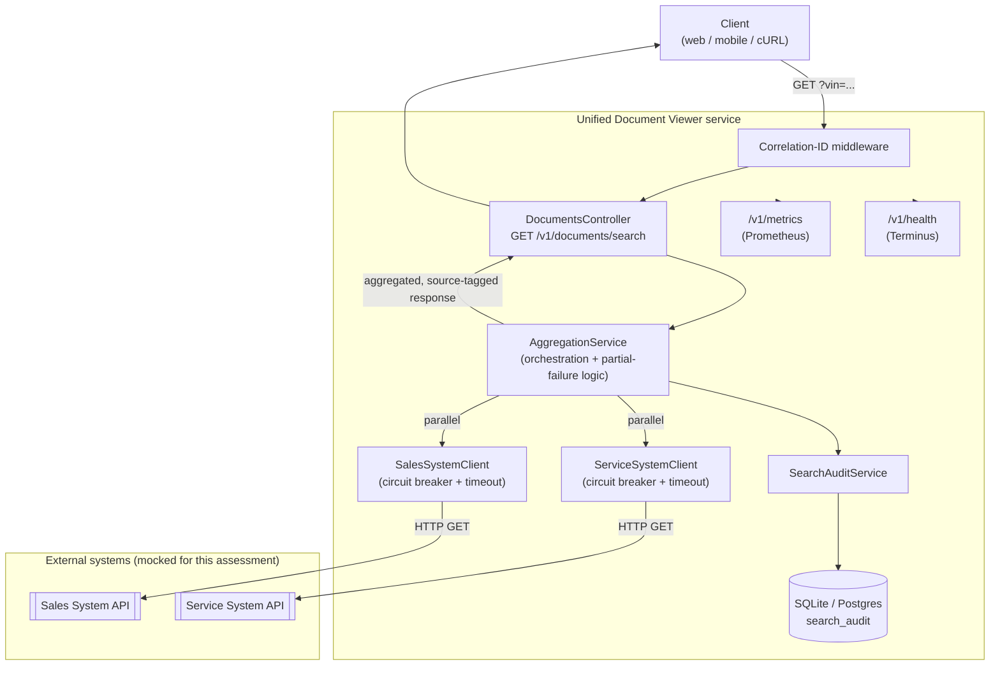

# System Design Document
## Keyloop Technical Assessment — Scenario D: The Unified Document Viewer

## 1. Problem restated

Given a VIN, return one consolidated list of every document related to that
vehicle, sourced from two independent dealership systems (Sales, Service),
clearly tagged by origin. The two systems must be called **in parallel**,
and the design must hold up as "for the future" — scalable, performant,
reliable, maintainable, observable.

The core engineering problem is not the lookup itself but the **integration
risk**: two upstream systems Keyloop doesn't fully control, each able to be
slow, erroring, or simply absent for a given VIN, and the UI still needs a
sensible answer.

## 2. Architecture diagram

## 3. Component roles

| Component | Role |
|---|---|
| **Correlation-ID middleware** | Assigns (or echoes) a request-scoped ID used to stitch together every log line, metric, and audit record for one search, across both parallel upstream calls |
| **DocumentsController** | Thin HTTP boundary: validates the VIN (`class-validator`), delegates to the aggregation layer, returns its result untouched |
| **AggregationService** | The core business logic. Fires both upstream calls concurrently (`Promise.all` over two independently-error-handled calls, not `Promise.all` over the raw calls — see §5), classifies each outcome, merges + source-tags the documents, decides `FULL` / `PARTIAL` / `FAILED`, persists the audit record, and only throws (503) when **both** sources fail |
| **SalesSystemClient / ServiceSystemClient** | One per upstream system. Each wraps its HTTP call in its **own** circuit breaker and timeout, so a failing Service System cannot affect the Sales System's health or vice versa |
| **CircuitBreaker** | Generic CLOSED → OPEN → HALF_OPEN state machine (custom, ~100 LOC, fully unit-tested). Trips after N consecutive failures; fails fast (no network call) while OPEN; allows one trial call after a cool-down |
| **SearchAuditService / `search_audit` table** | Durable record of every search: VIN, correlation ID, per-source outcome/latency/doc-count, total duration. Audit writes are wrapped so a persistence failure never breaks the user-facing response |
| **Mocked Sales/Service System controllers** | Stand-ins for the two real external systems named in the brief. In production these would not exist in this codebase at all — only the client base URLs would change |
| **`/v1/metrics`, `/v1/health`** | Prometheus scrape target and liveness/readiness probe, respectively |

## 4. Data flow (happy path)

1. Client calls `GET /v1/documents/search?vin=1HGCM82633A004352`.
2. Middleware assigns a correlation ID (or reuses the caller's `x-correlation-id`).
3. `DocumentsController` validates the VIN shape and hands off to `AggregationService`.
4. `AggregationService` calls `SalesSystemClient.fetchDocuments()` and
   `ServiceSystemClient.fetchDocuments()` **concurrently** — total latency
   is `max(salesLatency, serviceLatency)`, not the sum.
5. Each client: checks its circuit breaker state → if CLOSED/HALF_OPEN,
   makes the HTTP call with a bounded timeout → records success/failure
   against its own breaker and against Prometheus metrics.
6. `AggregationService` waits for both outcomes (each independently
   caught — one failing never cancels or throws for the other), tags each
   returned document with its `sourceSystem`, and merges them into one
   list.
7. `AggregationService` computes `overallStatus` (`FULL` if both
   succeeded, `PARTIAL` if exactly one did, `FAILED` if neither did) and
   persists a `SearchAuditEntity` row.
8. If `FAILED`, a `503 ServiceUnavailableException` is thrown (still after
   the audit write). Otherwise the aggregated, source-tagged response
   (`200`) is returned, including a per-source status summary so the
   client UI can show "Service System temporarily unavailable — showing
   Sales documents only" rather than silently hiding data.

## 5. Key design decisions

**Partial failure is not an error.** The brief's acceptance criteria don't
say what happens when one system is down, but a documents-lookup tool that
goes fully dark because one of two sources hiccupped would be a worse
product than one that degrades. I treat `PARTIAL` as a normal `200`
response with an explicit per-source status, and reserve `503` for the
case where the response would otherwise be empty and misleadingly "successful."
This is the single largest assumption I made beyond the literal spec, and
it's the one I'd most want to confirm with a PM in a real project.

**Per-client circuit breakers, not one shared breaker.** The two upstream
systems are unrelated failure domains; coupling their breakers would mean
a Service System outage could also fail-fast valid Sales System calls.

**A dedicated fixture VIN to make concurrency provable, not just asserted.**
"Calls happen in parallel" is easy to claim and hard to see. `PARALLELDEMO00001`
gives the Sales and Service mocks fixed, deliberately mismatched latency
(~1500ms / ~300ms) so `totalDurationMs` in the response makes the point on
its own: it tracks the slower call (~1500ms), not the sum (~1800ms) a
sequential implementation would produce. This is asserted directly in
`documents.e2e-spec.ts` rather than left as something to eyeball.

**Timeout + circuit breaker together, not just one.** A timeout alone
bounds a single call's latency but still hits a dying dependency on every
request; the circuit breaker additionally protects the dependency (and
this service's own thread/connection pool) once a failure pattern is
established.

**SQLite for the assessment, swappable for production.** Chosen purely to
keep `npm install && npm start` from requiring a running Postgres/MySQL
instance for a reviewer. The persistence layer only touches
`TypeORM`'s repository API — swapping `type: 'better-sqlite3'` for
`type: 'postgres'` (plus connection config) in `app.module.ts` is the only
change needed; no entity or service code is SQLite-specific.

**Audit persistence must never break the search.** `SearchAuditService.record()`
catches and logs its own failures rather than propagating them — a
customer-facing VIN search should not 500 because the audit table is
briefly unavailable.

## 6. Technology choices & justification

| Technology | Justification |
|---|---|
| **NestJS (TypeScript)** | Dependency injection makes the client/breaker/service layering easy to unit-test in isolation (see `aggregation.service.spec.ts`, which mocks both clients directly); decorators keep validation and versioning declarative |
| **TypeORM + better-sqlite3** | Persistent audit trail with zero external setup for review; trivially portable to Postgres for production (see §5) |
| **Custom circuit breaker over a library (e.g. `opossum`)** | At ~100 lines with 6 dedicated unit tests, a bespoke implementation is easier to reason about and fully own for an assessment whose evaluation criteria explicitly include "your process for verifying... and owning the final solution" — and it mirrors a pattern I've built and run in production before |
| **`nestjs-pino`** | Structured JSON logs are what a real log aggregator (Loki/ELK/Cloud Logging) needs; human-readable pretty-printing only in dev |
| **`prom-client`** | Prometheus is the de facto standard scrape format; trivial to wire into Grafana |
| **class-validator DTOs** | Declarative VIN validation at the HTTP boundary, consistent with Nest's `ValidationPipe` |
| **Jest + Supertest** | Standard Nest testing stack; supports both isolated unit tests (mocked clients) and full-stack e2e tests (real HTTP, real mocked-upstream controllers) 
| **`@nestjs/swagger`** | Interactive "try it out" client harness at `/api/docs` — satisfies the brief's "mock or stub the client-side layer with a simple test harness" option without hand-rolling a UI; also documents the API contract itself |

## 7. Observability strategy

- **Logging**: structured JSON via `nestjs-pino`; every request gets a
  correlation ID (generated, or echoed from an incoming
  `x-correlation-id` header) that's attached to every log line for that
  request — including the two concurrent upstream-client log lines — so a
  single search can be traced end-to-end in a log aggregator even though
  two calls happened in parallel.
- **Metrics** (`/v1/metrics`): `document_viewer_upstream_calls_total{source,outcome}`,
  `document_viewer_upstream_call_duration_seconds{source}` (histogram),
  `document_viewer_search_requests_total{outcome}`, plus Node default
  process metrics. This is enough to alert on "Service System failure
  rate > X%" or "Sales System p99 latency > Yms" independently per
  upstream, and to see circuit-breaker trips as a spike in the
  `circuit_open` outcome label.
- **Audit trail**: `search_audit` is a queryable, durable record per
  search — useful for "what did the customer's search actually return at
  2pm yesterday" debugging that log retention alone doesn't reliably give
  you.
- **Health**: `/v1/health` checks DB connectivity for
  liveness/readiness probes.
- **At scale, next step**: replace the correlation-ID-in-logs approach
  with real distributed tracing (OpenTelemetry spans across the
  controller → aggregation → both client calls), since once the Sales and
  Service systems are genuinely separate services (not mocked
  in-process), a trace waterfall becomes more useful than log
  correlation alone for diagnosing *which* leg of the parallel call was
  slow.

## 8. Scaling this beyond the assessment

- **Caching**: VIN → document-list results are natural cache candidates
  (e.g. Redis, short TTL) if the same VIN is searched repeatedly in a
  dealership session — would cut upstream load without changing the
  aggregation contract.
- **Horizontal scaling**: the service is stateless aside from the audit
  DB, so it scales horizontally behind a load balancer; the audit DB
  would move to a shared Postgres instance (see §5) rather than per-instance SQLite.
- **More than two sources**: `DocumentSourceClient` is already an
  interface, and `BaseDocumentSourceClient` already factors out
  circuit-breaker + timeout + metrics; adding a third source is "add a
  client, add it to `Promise.all`, extend the response DTO" rather than a
  rewrite.
- **Bulkheading**: at higher load, give each upstream client its own
  bounded HTTP agent/connection pool so one saturated dependency can't
  exhaust connections available to the other.

## 9. How GenAI was used in the design phase

I made every architectural decision in §5 myself before writing or
generating any code — parallel calls with independent failure handling,
per-client circuit breakers, partial-failure-as-200, SQLite-swappable-for-
Postgres persistence, and the metrics/logging shape. I used Claude
conversationally to:

- **Pressure-test the plan**: I described the "partial failure = 200 with
  per-source status" decision and asked what I might be missing; it
  correctly flagged that audit-write failures shouldn't be allowed to
  break the user-facing response, which I hadn't explicitly decided yet
  and then wrote into `SearchAuditService.record()`.
- **Draft this document's structure** from my bullet-point plan, which I
  then edited for accuracy (e.g. tightening the "why partial-failure is a
  200" framing, which the first draft under-explained) and to remove any
  claim not actually load-bearing.
- **Generate the Mermaid diagram** from a description of the component
  list and call directions I dictated, which I then checked node-by-node
  against the actual module wiring in `src/app.module.ts`.

Implementation-phase AI usage (scaffolding, debugging the two integration
bugs found during verification) is documented separately in the
repository's `README.md` under **AI Collaboration Narrative**, since that
process was iterative with the code rather than a discrete "design" step.
